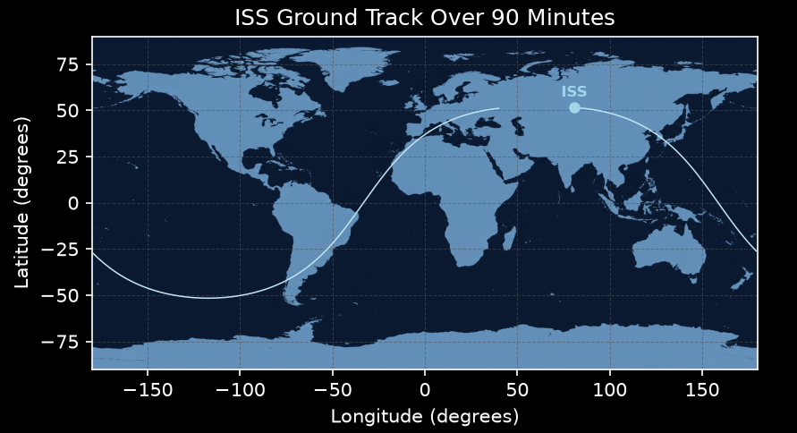

# ISS Ground Track Plotter

This program automatically downloads the TLE of the International Space Station (ISS) and outputs a world map of the ISS's location and its trajectory for the next 90 minutes.

## Features
A menu that displays 4 options by inputting its respective number:
- ( 1 ) Information about the ISS such as its current speed, altitude, longitude, and latitude 
- ( 2 ) Plot the current location of the ISS along with a prediction line of its location in the next 90 minutes
- ( 3 ) A check data feature that runs 9 checks to ensure all data used is correct
- ( 0 ) Exit

## How it works
- It first downloads the latest TLE from celestrak.org (unless the saved TLE file is less than 6 hours old)
- The last 2 lines of the TLE are run through `Satrec.twoline2rv`, which turns them into a satellite object that sgp4 can calculate positions from.
- The `sgp4` function takes that satellite object and a time in Julian date format, and outputs the ISS's position and velocity as Cartesian (x, y, z) coordinates. The velocity is used for the current speed, and the position is calculated every 30 seconds for the next 90 minutes, which is close to 1 orbital period of the ISS (~92.7 minutes)
- The latitude and longitude are found from the x, y, z positions using trigonometry. Since the Earth rotates underneath the orbit, the program subtracts how far Greenwich has rotated at each time step to get the correct longitude
- The latitude and longitude are plotted on a world map where the dot displaying the ISS is the current position of the ISS at the time the program was run
- To validate the results, I compared the program's current latitude and longitude with a live ISS tracker and they matched within about 0.3 degrees

## How to run
    pip install -r requirements.txt
    python ground_track.py

## What I learned
First, this wouldn't have been possible without 30-Days-Of-Python. The majority of the coding I did was possible from that course. Of course, there are some new things I had to search and learn such as matplotlib and its functions, numpy arrays, and sgp4 for orbital mechanics.

I made mistakes, like using a for loop on an array when you can just do maths on the whole array at once. That's one I won't forget. Other things were completely new to me, such as np.insert creating a whole new array instead of modifying the array I passed into it.

This was my first real programming project, so almost everything I've done was a learning experience. Yes there were some moments of madness, but in the end I got through them, and getting the final result I was expecting at the end of the day is always the best feeling.

The thing I'm most proud of is organizing the code. I spent a big part of my time organizing it and creating a dedicated function for checking the data only. Maybe it was unnecessary, but I believe it was a major part of my project too.

Full day-by-day log: [learning_log.md](learning_log.md)

Python course that taught me the majority of the language: [30 Days of Python](https://github.com/Asabeneh/30-Days-Of-Python) by Asabeneh Yetayeh

## Data
- TLE Data: https://celestrak.org/NORAD/elements/gp.php?CATNR=25544&FORMAT=TLE
- World map: based on NASA Blue Marble imagery, restyled to a minimalist two-tone version using AI.