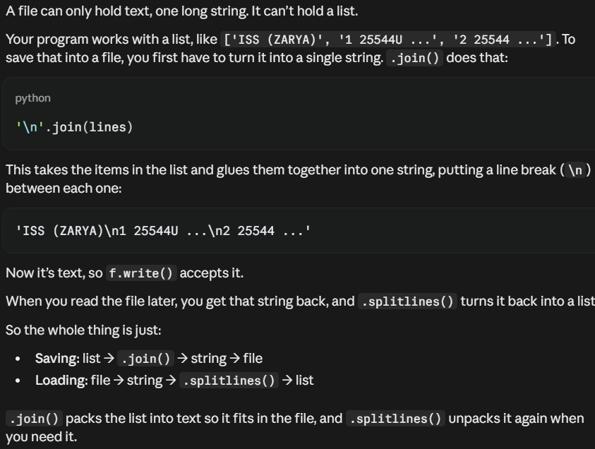
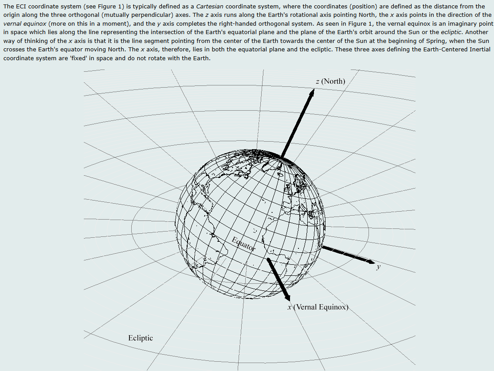
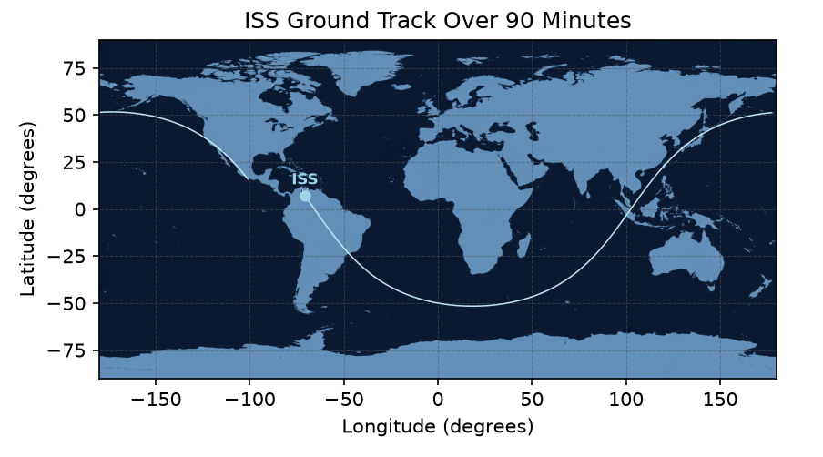

# What I understand

## Day 1

I had to install python 3.14 and open VS Code on my folder’s project which i called iss-ground-track. to make sure of the python version i wrote ( python --version). The folder itself should avoid being inside an online storage to not cause any future problems.

 I had to then link my github with the folders project using these functions:

- first install git using winget install --id Git.Git -e --source winget which stays on my computer so i dont have to do it again. Then id have to configure it so that it would store my information by:
    - git config --global user.name "amrsamman"
    - git config --global user.mail"amr-samman@outlook.com"
    - git config --global init.defaultBranch main Which is for naming my main branch main
    - git config --global core.editor “code --wait”

Then I had to install the libraries sgp4 numpy matplotlib using pip install “respective library”

- sgp4 is orbit physics that can turn TLE into a position in space, and it was developed by the US Air Force space tracking and even accounts for things like Earth not being a sphere and atmospheric drag.
- numpy: fast mathematics on whole lists of numbers at once.
- matplotlib: just for plotting

Then these libraries are imported into the folder project in VS code powershell using python -c ‘import (then all the libraries separated with commas)’

I want the folder to be a git project so i used “ git init ” in the powershell inside the folder.

In the terminal i wrote python -m venv .venv then .venv/Scripts/[Activate.ps](http://Activate.ps)1 which this is used because when you do “pip install numpy” it has to be saved somewhere so without a venv it goes to the main python on my laptop and saves it to all python projects. So this venv file is a virtual environment that acts like a toolbox and the python install is the workshop and this project needs to have its own set of tools.

the .gitignore file is also inside the folder because its a list of things that git should pretend that it doesnt exist.

## Day 2:

The next step is saving the ISS Data which is done by these steps:

- going to [https://celestrak.org/NORAD/elements/gp.php?CATNR=25544&FORMAT=TLE](https://celestrak.org/NORAD/elements/gp.php?CATNR=25544&FORMAT=TLE) and copy the 3 lines that is called a TLE
    - A TLE is a two-line element set that is a standard text format every satellite tracker uses, it has 3 informations: Line 0 is its name, Line 1 is when this snapshot of the orbit was measured (the epoch)  and line 2 describes the shape of the orbit.
    - For example in the 2nd line the number 51.6325 is the angle of inclination, and the number 15.5 is the amount of times it orbits around the day.
- then I created a function called load_tle so it would input the path of the tle iss data txt file and load the last 2 lines of the TLE text cuz thats what i need for the program to work

```python
def load_tle(path):
    with open(path) as text:
        tle = text.read().splitlines()[1:]
        return tle
```

## Day 2.5:

Actually nevermind i dont wanna copy and paste the tle every single time so i decided to research how caching works and now i automated a way so that it downloads the TLE every 6 hours. (future me here: i hate my past self)

- Downloading it every single time i run the code is problematic and would probably let the celestrak website block me i think idk, so instead by using a formula with os, requests, and time modules i found online. I created the function get_iss_tle

```python
def get_iss_tle():
    if os.path.exists(file_name):
        age = time.time() - os.path.getmtime(file_name)
        if age < max_age:
            print('using saved file')
            with open(file_name) as f:
                return f.read().splitlines()[1:]

    print('downloading')
    response = requests.get(url)
    lines = response.text.splitlines()

    with open(file_name, 'w') as f:
        f.write('\n'.join(lines))

    return lines[1:]
```

- The only problem i faced with this is the .join(lines) thing which i actually didnt include in the first place, but apparently after reviewing the code with claude it told me it would be a problem:



- this process took me a few hours to understand and it strengthened my decision of not becoming a data analyst in the future. Oh and i included timeout = 10 inside the requests.get(url) so it would be requests.get(url, timeout = 10) since claude said to include this incase celestrak bans me or my internet was off so the program doesnt just freeze, it would just give up.

Alright now that the last 2 lines of TLE is automated and final, it is time to work with. The first thing I need to do is write a code that says:

```python
if __name__ == "__main__":
```

and i need to work on everything else under this (future me here, pls everything needs to be INDENTED AFTER THIS CONDITION OTHERWISE ITLL BE OUTSIDE THE IF CONDITION WHICH WAS A HUGE MISTAKE).

Now there is a few new variables i made:

- sat = Satrec.twoline2rv(line1, line2) to turn the TLE into a satellite object and hold the ISS’s orbit, ready to calculate positions from it.
- where time_now = datetime.now(timezone.utc) (yes it needs to be UTC)
- jd, fr = jday(time_now.year, time_now.month, time_[now.day](http://now.day), time_now.hour, time_now.minute, time_now.second) that converts the time_now into a julian date that sgp4 needs in order to work which honestly im not even gonna question it
- Now this is a fun part: error, r, v = sat.sgp4(jd, fr) the sat.sgp4(jd, fr) uses the TLE information that the sat variable used, along with the time right now with jd and fr, and it outputs 3 variables hence why naming ‘ error, r, v ‘ where error is literally error it tells me if theres an error in the calculation (e = 0 means no error), r is the radius from the centre of the earth but in 3 dimensional components, and v is the velocity also in 3 dimensional components
- We will then be using the r and v variables where each r and v has 3 sub values in them.
- For r, i will create a variable h where h = ( r[0]**2 + r[1]**2 + r[2]**2 )**0.5 - 6378.137 (literally the distance formula) to find the height but the reason i included - 6378.137 is because we want the distance from the surface of the earth to the orbit.
- for v ill do the same thing above to find the speed in km/s but ofc without the subtraction
- Wait this all worked in one go??? except claude told me to include this thing incase things go wrong with the error: which i actually remembered this is from the 30-days-of-python

if error != 0:
raise RuntimeError(f"sgp4 failed with error code {error}")

im done for day 2 because learning what caching is took all my energy….

## Day 3:

ok so before we do anything i had claude review my code just incase, and i had to add a line which makes sure the request line code in the function for getting the iss tle works, if not itll output the error code with the following code :     response.raise_for_status() 

I also needed to import numpy as np cause we will be using it today.

ok now i need to make a new function called propagate to predict the position of the satellites trajectory in the next minutes, for this function the default parameter will be 90 minutes with a step for 30 seconds so i dont have too much data. And when i told this plan to claude he told me i should also return the list for times as well for future use so ill have to figure that out too.

My final function (after 1 whole hour) is this:

```python
def propagate(sat, jd, fr, minutes=90, step_s=30):

    positions = []
    times = []
    offsets = range(0, minutes * 60 + step_s, step_s)

    for i in offsets:
        error, r, _ = sat.sgp4(jd, fr + (i / 86400))

        if error != 0:
            raise RuntimeError(f"sgp4 failed with error code {error}")

        positions.append(r)
        times.append(jd + fr + (i / 86400))

    return np.array(positions), np.array(times)
```

ofc i did many mistakes for it like:

- First i knew that fr was in days but were working with seconds, but apparently converting fr to seconds was a mistake so you have to convert the offset value from seconds to days instead. If only i put the if error ! = 0 then raise runtimeerror before this because without it, the code kept not working and i wasnt sure why, so everytime we get an error variable, i always have to include that just incase.
- i needed the function to return positions AND times but i did two mistakes
    - First is that i made the “times” list where it had the range function and returned times as itself and thought its ok, but i realized it needs to be in the julian format thing so i had to create a new variable called offsets where the range function will be ,and times is a new empty list that will be filled with the julian type of time.
    - i returned the lists as a normal list, but it needed to be a numpy array.
- in the offsets list, i initially wrote range(0 , minutes * 60, step_s) but this only creates a range from 0 to 5370 (but i need till 5400) so  i wrote range (0, minutes * 60 + 30, step_s), and that also should be the case cause i realized a while after that we MIGHT want to change the step_s to be a value that we choose, so it needs to be what it says on the finalized function that i made up.

Now something i learnt today is that when you have a numpy array, you can use the np.linalg.norm function to find the magnitude of a row in an array, for example np.linalg.norm(array) where the array = (x, y, z) it will output (x^2 + y^2 + z^2)^0.5 

that was basically it for day 3, it was creating that function, but i also spent another hour creating a section in a program that is only meant for checking the data, which is extremely long so i wont paste it here but it basically confirms stuff like the speed of the ISS is between 7 and 8, and that the TLE values are 69 characters long. That way im sure that none of the data is incorrect from here on out and in the future.

## Day 3.5:

im studying physics so i cant make this long, im just gonna organize the place.

The first thing is the check data section, its huge as hell and i honestly want it to print only when i want it to, so i decided to move it ALL to a check_data function. I also made it so that it output the value always so id know what went wrong.

I also saw that the altitude checking data was wrong because it was checking each 181 values and updating whether its between 350 and 450 (true if it is, false if it isnt) but if theres a value in the middle that was false, we wouldnt know cause it would be replaced by a later value that was true. So i made the checking stop the moment it found a false by using “break” that i completely forgot about.

## Day 4:

okay today is a tough day, ill have to find some way to translate the x y z positions into longitude and latitude so i spent near 2 hours figuring out how that works. Today i realized that the longitude and latitude are actually angles and not just random mapping  x y values on a 2d map. I now also understand why i needed the time array with the positions, its because apparently the longitude is taken from the greenwich, and the greenwich is rotating with the earth which i can work around with by using the time array.

I found a website that actually explained it all perfectly and it was the same website i used to extract the TLE from. https://celestrak.org/columns/v02n01/



now for the longitude:

- I first need to find the ISS’s angle on the north pole so im looking parallel to the z axis therefore i can measure the angle using only the x and y value, but then ill have to subtract how far the greenwich turned (which is then gonna be calculated from the time array)

$$
\text{longitude} = \operatorname{arctan}(y/x) - \theta
$$

for the latitude:

- now for this, the angle is the ISS above the equator, and we know from the diagram that the equator is just the magnitude of x and y since it lies in the x-y plane.  Then that magnitude is used with the z value to find the latitude

$$
\text{latitude} = \operatorname{arctan}\!\left(z/\ \sqrt{x^2 + y^2}\right)
$$

okay now how did i find theta to subtract from the angle to find the longitude? i had no idea i just googled it and im using the numbers and i double checked with claude to make sure its correct and he refined it for me.

$$
\theta = 280.46061837^\circ + 360.98564736629^\circ \times (\text{JD} - 2451545.0)
$$

Now to create the to_lat_lon function, its basically just doing the formula above but theres some new things i learnt:

- i gotta use numpy’s arctan2 function for the 2 values so it can differentiate between opposite directions

and of course i messed up:

- I spent half an hour figuring out how to actually make theta between 0-360 and i completely forgot % existed.
- i at first did a for loop and failed miserably over and over not sure why it wouldnt work, but then i realized, why am i looping? i can just calculate using the arrays directly. Im rewriting the whole thing now.
- when i found the longitude it wasnt giving me the right values for some reason, i knew the values had to be between -180 and +180 but I gave up and searched it up and apparently i needed to add 180, then modulus 360 then subtract 180 and then it would output the angles to be within that range. I didnt get it but i just did it and it worked so yay.

So now my final check to make sure that this works can be done in 2 ways:

- check for the highest latitude and longitude where the highest latitude will be 51.6 degrees and the longitudes should range from -180 to 180
- run the function and get the first angles and compare it to an actual live tracker

i of course did the 2nd way, and holy crap it actually worked. I actually tracked the ISS Live.

im so done for today

## Day 4.5

today i added 3 new checks in the check_data section, which to be honest all i  did was write the title and VS Code copied the patterns of my previous checking data lines of codes and just did it for me automatically. But it did one of them wrong that i realized i had to fix a minute after, which was ensuring that the latitude is between 51 and 52 degrees, it used a for loop for the whole thing but i wanted it to use the max() and min() since thats simpler.

## Day 5

Its time to plot it. I first imported the matplotlib library and checked online for the most simplest way of plotting points and i just copied and pasted it. The only problem.. There was a straight line from the left and right. I stayed confused for a straight few hours (even got me thinking about it the whole MATLAB Lecture at uni since i was doing this in the morning) and in the end i gave up and asked claude for a hint, the hint was that each 2 points are just drawn a line next to each other. Its literally a computer ofc it has to do that, and since the longitude has a sudden value jump from 180 to -180 at some point, so it literally drew a line at x = 180 to x = -180 at 1 y value which is the latitude. So i had to test out some new features with numpy which was the np.nan and np.insert. Which i just inserted a NaN between the -180 and 180. but again another thing that TOOK ME 2 HOURS TO FIGURE OUT. When using np.insert it CREATES A NEW ARRAY. I kept printing the original longitude array and wondering why its not working until i searched on google examples of using np.insert and saw they all printed out the np.insert. After that. I finally have it

Now i wanted to format it, so i searched online for ways to: add a background, change the color, change the opacity, and more. Most of the formatting ive done is literally copied and pasted since it was all straight forward (except the sizes and color ofc i chose them). But at least i got to know all the different types of formatting with plots. And now i present my final design.



Well not final design, i still have more stuff i want to improve in it but this is it for now.

Now.. To make it live (I dont have the sufficient skills to do this)